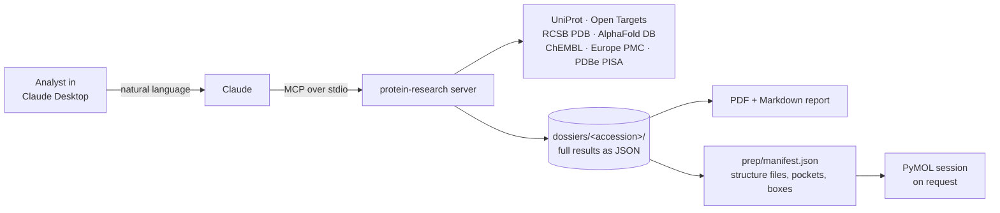

# protein-research MCP

A local [Model Context Protocol](https://modelcontextprotocol.io/) server that turns Claude Desktop into a target-assessment assistant for drug discovery. Ask it to *review the protein BRAF* and it resolves the protein, gathers annotation, disease evidence, structures, ligands and literature from public databases, and builds a report in which every value links back to its source. It can then prepare structure files for in-silico experiments.

The intended reader of the output is a drug-discovery analyst. The design goal is that nothing reaches that reader without a retrieved source.

**[See a sample report: BRAF V600E (PDF, 9 pages)](docs/sample_report/report_P15056.pdf)**, also available as [Markdown](docs/sample_report/report_P15056.md). It was generated from live APIs with the code in this repository.

## Design principles

- **Links come from the source.** Every URL is built from an identifier that the database returned, and tests check this against the saved records. The sample report has 281 links (176 unique), all backed by its dossier.
- **Missing data stays missing.** Empty fields read `no record`. Names are never inferred: most research compounds in ChEMBL have no name, and the report does not give them one.
- **Selections are declared.** Lists state "N of total" and how they were chosen, for example "7 of 38 entries" or "At least 1740 ligands" when a download is truncated.
- **Failure is not absence.** A query that failed is reported as unknown, never as "none found". A nonexistent, deleted or merged UniProt accession returns an error rather than an empty result.
- **The report is deterministic.** Python lays out the saved records, and the server never calls an LLM. Interpretation happens in the chat, where Claude cites the data, and it is kept out of the PDF.
- **Choices belong to the user.** Structures are not ranked for docking, because the tool does not measure conformation or fit. The analyst picks one, and `select_structure` records that choice with the analyst's reason.

## How it works



Each tool saves its full result to a dossier on disk and sends Claude a compact view, so the chat stays small while the report still has everything.

## Tools

**Phase 1: research and report**

| Tool | Source | What it returns |
|---|---|---|
| `resolve_protein` | UniProt | Accession candidates for a protein or gene name; asks when ambiguous |
| `get_protein_profile` | UniProt, Open Targets | Function, location, diseases, variants, association scores, tractability flags |
| `get_structures` | RCSB PDB, AlphaFold DB | A diverse selection of PDB entries, with an optional variant filter confirmed per entry, plus the AlphaFold model |
| `get_ligands` | ChEMBL | Ligands by potency per mutation and assay type, with development phase; drugs without IC50/Ki/Kd, such as antibodies, are listed separately |
| `search_literature` | Europe PMC | Papers with abstracts and links; preprints only on request, and flagged |
| `build_report` | Dossier only | PDF and Markdown report |

**Phase 2: preparing in-silico experiments**

| Tool | What it does |
|---|---|
| `prepare_structures` | Downloads the original files with checksums, writes cleaned receptors, and computes chain metrics, ligand pockets and boxes into a manifest |
| `open_in_pymol` | Writes a PyMOL session (`.pml`) and opens it if PyMOL is installed |
| `pymol_view` | Changes the open PyMOL view through a closed list of actions; the chat never sends PyMOL commands |
| `select_structure` | Records the user's structure, chain and pocket in the manifest after validating them |
| `analyze_interfaces` | Reports partner chains, construct sequences, RCSB assemblies, PDBe PISA interfaces and protein-protein contacts in UniProt numbering |

## Example

In a new Claude Desktop chat:

```text
Review the protein BRAF in human.
Give me the target profile.
Show structures and ligands for the V600E mutation.
Find papers about V600E inhibitors.
Build the report.
Prepare the V600E structures and open them in PyMOL.
I choose 8C7Y, pocket TXV U, because ...
```

From that kind of session, the [sample report](docs/sample_report/report_P15056.pdf) shows:

- 7 of 38 RCSB entries found for V600E, with 26 of the 38 confirmed to name the variant and 12 discarded.
- At least 1740 ligands with qualifying data for V600E (download truncated and declared), with clinical-stage compounds listed first.
- 10 ligand pockets across 7 prepared structures, including chain-level checks. In 3OG7, for example, the vemurafenib pocket is in chain A, where position 600 is not modelled, while GLU 600 is modelled in chain B.

The sample was generated without the last prompt, so its section 6 reads "No structure chosen": that choice and its reason are a person's to make. It also omits `analyze_interfaces`, which is aimed at targets of biologics.

## Installation

Requirements: Windows, [uv](https://docs.astral.sh/uv/), [Claude Desktop](https://claude.ai/download) and internet access. Python 3.13 or later is required, and no API keys are needed.

```powershell
git clone https://github.com/leorosas7777/protein-mcp.git C:\bioinformatics\protein-mcp
cd C:\bioinformatics\protein-mcp
uv sync
```

In Claude Desktop, go to *Settings → Developer → Edit Config* and add:

```json
{
  "mcpServers": {
    "protein-research": {
      "command": "uv",
      "args": ["--directory", "C:\\bioinformatics\\protein-mcp", "run", "protein-mcp"]
    }
  }
}
```

Quit Claude Desktop from the system tray, reopen it, and start a new chat. The 11 tools should appear.

PyMOL is optional. The [usage guide](docs/USAGE.md) covers how to set it up, which prompts work, and what the server does not do.

## Testing

Offline tests use fixtures copied from real API responses, including their real defects:

```powershell
uv run python tests/test_chembl.py      # same pattern for every tests/test_*.py
```

Live tests call the real APIs through the server code and write to a temporary folder:

```powershell
uv run python tests/smoke_live.py --skip-slow
uv run python tests/smoke_live.py notfound prep interfaces
```

They include external checks that do not depend on this code (approved drugs, known diseases), regression checks for defects already fixed once, and anti-hallucination checks on the output.

## Project layout

```text
protein_mcp/
  server.py          registers the tools; their docstrings tell Claude how to use each result
  report.py          dossier -> PDF + Markdown (never calls an API)
  dossier.py         saves and reads results on disk
  target_profile.py  combines UniProt and Open Targets
  sources/           one module per database
  files/             Phase 2: download, clean, prepare, choice, viewer, control, interfaces
tests/               offline tests with real fixtures, plus smoke_live.py
docs/                usage guide, interpretation guide, demo script, sample report
```

## Known limitations

- **Windows only so far.** The PDF uses the Arial font from Windows, and the PyMOL launch has only been tested on Windows.
- **Polyproteins are not split.** For SARS-CoV-2 P0DTD1, the main protease has no accession of its own, so structures and ligands mix domains.
- **Ranking is by potency.** It favours single measurements and says nothing about selectivity or developability. Selectivity, ADME and toxicity are not retrieved.
- **Large targets are truncated.** For EGFR only the most potent activities are examined, plus those of compounds with a recorded mechanism. The output says so.
- **Text search can miss entries.** RCSB's full-text search misses entries that name a variant only as part of a word in the title, such as "KRasG12D".
- **PDB ligands are not linked to ChEMBL.** A ligand without a wwPDB synonym is identified only by its chemical name and the entry title.
- **PDBe PISA uses older XML services.** They may disappear, and recent entries may be absent. When that happens, the output says PISA was not available.
- **Contacts are geometry.** They are distances up to 5 Å in a crystal, and do not prove a contact in solution.

## Roadmap

Phase 3 will start experiments from the Phase 2 manifest: docking and molecular dynamics for small molecules, and complex prediction for biologics, with a human review before anything runs. A structure with the user's choice, pocket and box is already recorded for that hand-off. Phase 3 has not been started.

## Data sources

[UniProt](https://www.uniprot.org/), [Open Targets](https://platform.opentargets.org/), [RCSB PDB](https://www.rcsb.org/), [AlphaFold DB](https://alphafold.ebi.ac.uk/), [ChEMBL](https://www.ebi.ac.uk/chembl/) (CC BY-SA 3.0), [Europe PMC](https://europepmc.org/) and [PDBe PISA](https://www.ebi.ac.uk/pdbe/pisa/). Data retrieved through this server remain subject to each provider's terms. This is a research tool, and its output needs expert review.
